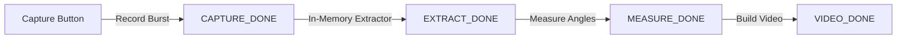
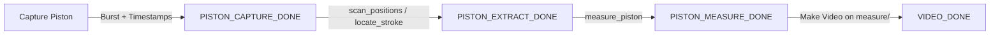
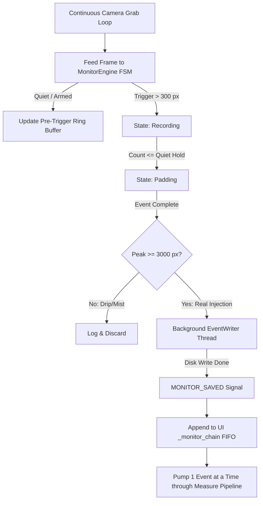

# System Architecture & Data Flow

This document details the high-level architecture, software modularization, concurrency models, thread communication patterns, and disk data flow for the spray angle and high-speed camera test rig codebase.

---

## 1. High-Level Architectural Design

The system is designed around a multi-tier architecture separating hardware capture, computer vision extraction, mathematical measurement, user interface presentation, and data persistence:

```mermaid
graph TD
    subgraph Hardware Layer
        CAM[Huaray AH7040MU000 Camera]
        SDK[IMV C SDK / MVSDKmd.dll]
    end

    subgraph Acquisition & Worker Tier
        CW[Camera Worker Thread / CameraController]
        PREV[Live Preview Ring Stream]
        BURST[RAM Burst Buffer / Cloned Frames]
        MON[Online Monitor Engine FSM]
    end

    subgraph Processing & Algorithmic Tier
        SCAN[Motion Scanner: C++ OpenMP / Raw BMP]
        EXTRACT[Temporal & Presence Injection Extractor]
        TRACK[Piston Edge & Stroke Tracker]
        MEAS_ANGLE[Spray Angle Measurement Pipeline]
        MEAS_PISTON[Piston Speed & Travel Derivation]
        CALIB[Spatial & Gauge Block Calibration]
        REF[Nozzle Reference & Target Rect Alignment]
        SUMM[Batch Cross-Run Statistics Engine]
    end

    subgraph Presentation Tier
        GUI[Desktop GUI: Tkinter / Qt6 Widgets]
        LOG[Persistent Logger app.log]
    end

    subgraph Storage Tier
        D_CAP[data/captures/]
        D_INJ[data/injection images/]
        D_MEAS[data/measure/]
        D_SET[settings/ & data/*.json]
    end

    CAM --> SDK
    SDK --> CW
    CW --> PREV --> GUI
    CW --> BURST
    CW --> MON
    BURST --> SCAN --> EXTRACT
    BURST --> TRACK
    EXTRACT --> D_INJ
    MON --> D_INJ
    D_INJ --> MEAS_ANGLE --> D_MEAS
    D_INJ --> MEAS_PISTON --> D_MEAS
    CW --> CALIB --> D_SET
    CW --> REF --> D_SET
    D_MEAS --> SUMM
    GUI --> CW
    GUI --> LOG
```



---

## 2. Dual-Stack Implementation Comparison

The repository currently maintains two parallel implementations:

| Attribute | Python Implementation (`High speed camera/`) | C++ Implementation (`C version/`) |
| :--- | :--- | :--- |
| **Language** | Python 3.13 (Managed by `uv`) | C++17 (MSVC 2022) |
| **GUI Framework** | Tkinter (`tk.Tk` + modular mixin hierarchy) | Qt 6.11.1 (Qt Widgets) |
| **Camera Interface** | Python C-types wrapper (`IMVApi.py`) calling vendored `MVSDKmd.dll` | Direct C linkage (`IMVApi.h`, `MVSDKmd.lib`, `MVSDKmd.dll`) |
| **Threading Model** | Single camera worker thread (`threading.Thread`) + Queue dispatch | `QThread` worker (`CameraController` moved to thread) + Qt Signals/Slots |
| **Native Acceleration** | Standalone C++/OpenMP executable (`injection_scan.exe`) | Directly compiled native binaries |
| **Analysis Pipeline** | Complete (Spray angle, piston tracking, gel, monitor, calibration, statistics) | **Missing / Incomplete** (Acquisition and preview only) |
| **Packaging** | PyInstaller one-folder standalone `.exe` | Direct CMake/MSVC executable + `windeployqt` |

---

## 3. Directory Layout & Repository Organization

```
spray-angle-test/
├── docs/                                  # Central system documentation (this suite)
├── AH7040MU000.pdf                        # Camera hardware datasheet
├── camera.SLDPRT                          # SolidWorks 3D model of camera
├── MV Viewer V2.4.2.3 使用手册.pdf       # Vendor camera viewer manual
├── 视觉产品线硬件选型手册_V1.13.pdf        # Hardware selection guide
├── sdk-archive/                           # Full vendor SDK archive across languages
│
├── C version/                             # C++ / Qt6 Implementation
│   ├── capture_image_cpp.cpp              # Standalone CLI burst capture tool
│   ├── CMakeLists.txt                     # CMake build configuration for CLI
│   ├── build_msvc.bat / run_capture.bat   # MSVC build & run batch wrappers
│   ├── Development/                       # Vendored IMV C headers (Include) and import libs (Lib)
│   ├── Runtime/x64/                       # Vendored IMV runtime DLLs (MVSDKmd.dll, etc.)
│   └── gui/                               # Qt6 Widgets GUI application
│       ├── main.cpp                       # Application entry point
│       ├── camera_controller.{h,cpp}      # QObject worker on QThread for IMV camera handling
│       ├── main_window.{h,cpp}            # Qt main window, controls, and preview panel
│       ├── CMakeLists.txt                 # Qt6 CMake build configuration
│       └── build_gui.bat / run_gui.bat    # GUI build & run wrappers
│
└── High speed camera/                     # Complete Python Implementation
    ├── run_gui.py                         # Main application entry point (GUI + PyInstaller entry)
    ├── pyproject.toml / uv.lock           # Dependency & package specifications
    ├── CLAUDE.md / README.md              # AI agent guidelines and user documentation
    ├── hsc/                               # Core Python package
    │   ├── app_paths.py                   # Dynamic resolution for resource_root() and data_root()
    │   ├── capture_image.py               # Low-level camera configuration & burst capture
    │   ├── injection_extract.py           # Temporal diff motion scanner & injection window detector
    │   ├── smart_save.py                  # Detect-before-write RAM planning module
    │   ├── monitor.py                     # Continuous streaming MonitorEngine finite state machine
    │   ├── frame_writer.py                # Asynchronous background BMP writer thread (EventWriter)
    │   ├── measure_angle.py               # Spray-angle CV pipeline (erf, RANSAC, TLS line fit)
    │   ├── piston_track.py                # Piston edge detection & stroke window bounding
    │   ├── measure_piston.py              # Piston speed, displacement, and jet pressure derivation
    │   ├── piston_plot.py                 # Pure OpenCV canvas line plotter (replaces matplotlib)
    │   ├── calibrate_scale.py / calibrate_ui.py # Spatial scale calibration (mm/px)
    │   ├── reference_lines.py / reference_ui.py # Nozzle tip & spray axis reference setup
    │   ├── measure_block.py               # Angle block single-still verification
    │   ├── summary.py                     # Cross-run descriptive statistics aggregator
    │   ├── make_video.py                  # Slow-motion MP4/AVI video synthesis
    │   └── gui/                           # Modular Tkinter GUI package (Mixin-based)
    │       ├── app.py                     # Main window class assembling all feature mixins
    │       ├── layout.py                  # Widget layout, buttons, parameters
    │       ├── camera_worker.py           # Persistent camera worker thread (preview + capture)
    │       ├── capture.py                 # Burst capture orchestration & still-request registry
    │       ├── extraction.py              # Find Injection handling
    │       ├── measurement.py             # Spray angle measurement orchestration
    │       ├── piston.py                  # Piston capture & measurement orchestration
    │       ├── gel.py                     # Gel capture orchestration
    │       ├── monitor.py                 # Monitor mode orchestration
    │       ├── calibration.py             # Calibration dialog wrappers
    │       ├── reference.py               # Reference dialog wrappers
    │       ├── summary.py                 # Multi-folder picker dialog & statistics view
    │       ├── video.py                   # Make Video orchestration
    │       ├── config.py                  # Global GUI constants, folders, and logging
    │       └── selftest.py                # Headless integration verification
    ├── native/                            # Fast native scanner source
    │   ├── injection_scan.cpp             # Multi-threaded OpenMP raw BMP diff scanner
    │   └── build_injection_scan.bat       # MinGW g++ static build script
    ├── vendor/                            # Bundled IMV SDK, DLLs, and compiled binaries
    │   ├── Development/                   # Python MVSDK wrapper
    │   ├── Runtime/x64/                   # Runtime DLLs
    │   └── bin/injection_scan.exe         # Precompiled fast scanner executable
    ├── packaging/                         # Standalone Windows packaging
    │   ├── HighSpeedCamera.spec           # PyInstaller build specification
    │   └── build_exe.bat                  # Automated build script producing dist/HighSpeedCamera/
    ├── benchmark/                         # Synthetic ground-truth validation suite
    └── tests/                             # 216 pytest unit & integration tests
```

---

## 4. Concurrency & Threading Architecture

High-speed camera streaming and frame analysis require strict decoupling of GUI event loops from camera I/O and CPU-intensive vision algorithms.

### 4.1 Python Threading Model
The Python system uses a **Single Persistent Camera Worker Thread** pattern:
- The camera is opened **once** on application startup.
- The same open camera handle handles both **Live Preview** (streaming at low display rate) and **Burst Capture** (max hardware FPS). This eliminates camera open/close latency, making the "Capture" button instant.
- **Worker Thread Execution**: Managed by `hsc/gui/camera_worker.py` (`_camera_worker_loop`).
- **Communication Channels**:
  - `output_queue` (Thread-safe `queue.Queue`): Passes status tuples `(KIND, payload)` to the GUI. Drained every $100\ \text{ms}$ by the Tk root window via `self.after()`.
  - `preview_queue` (Thread-safe `queue.Queue`, `maxsize=2`): Drops stale preview frames, ensuring the GUI thread renders only the latest frame without lag. Drained every $50\ \text{ms}$.
  - Mixin Handlers: Each mixin declares a `QUEUE_HANDLERS` dictionary mapping `KIND` strings (e.g. `CAPTURE_DONE`, `EXTRACT_DONE`, `MEASURE_DONE`) to class methods.

### 4.2 C++ / Qt6 Threading Model
The C++ implementation utilizes Qt's native worker pattern:
- `CameraController` inherits from `QObject` and is moved to an independent `QThread` worker instance:
  ```cpp
  workerThread_ = new QThread(this);
  controller_ = new CameraController();
  controller_->moveToThread(workerThread_);
  workerThread_->start();
  ```
- **Signaling**: Thread communication occurs strictly via Qt queued connections:
  - GUI $\to$ Worker: `QMetaObject::invokeMethod(controller_, "startPreview", Qt::QueuedConnection, ...)`
  - Worker $\to$ GUI: Qt signals (`previewFrame`, `captureStarted`, `captureFinished`, `logMessage`, `errorOccurred`).
- **Asynchronous Cancellation**: Stop commands flip thread-safe `std::atomic<bool>` flags (`stopPreview_`, `stopCapture_`). The tight camera frame acquisition loops check these atomics between frame fetches, terminating cleanly without thread killing.

---

## 5. Storage Tier & Data Directory Contracts

All runtime outputs are organized under `data/` (or relative to the `.exe` when frozen):

```
data/
├── app.log                                # Persistent application log with timestamps
├── calibration.json                       # Stored spatial calibration (mm_per_px, line params)
├── calibration.json.bak                   # Atomic backup copy
├── reference_lines.json                   # Stored nozzle reference lines and target rectangle
├── reference_lines.json.bak               # Atomic backup copy
│
├── captures/                              # Raw burst folders
│   └── 2026-08-12-14-07-22_320x240_runA/  # yyyy-mm-dd-hh-mm-ss_<aspect>[_<label>]
│       ├── frame_000001.bmp ...
│       └── piston_capture.json            # Hardware blockId & timestamp records (piston only)
│
├── injection images/                      # Extracted injection windows (copy_start..copy_end)
│   ├── 2026-08-12-14-07-22_320x240_runA/
│   │   ├── frame_000120.bmp ...
│   │   ├── injection_meta.json            # Bounds metadata (onset, end, peak, padding)
│   │   ├── piston_meta.json               # Extended metadata for piston runs
│   │   └── slowmo.mp4                     # Synthesized slow-motion playback video
│   └── monitor_2026-08-12-14-30-00_320x240/ # Monitor-mode auto-detected events
│       └── ...
│
└── measure/                               # Analysis results, reports, and overlays
    ├── 2026-08-12-14-07-22_320x240_runA/
    │   ├── frame_000120.bmp ...           # Annotated frames (green fitted lines, text)
    │   ├── <run>_angles.csv               # Spray angle report table (per-frame + mean)
    │   ├── <run>_speed.csv                # Piston displacement & velocity table
    │   ├── <run>_distance_time.png        # Piston displacement vs. time curve
    │   ├── <run>_speed_time.png           # Piston velocity vs. time curve
    │   ├── <run>_jet_speed_time.png       # Liquid jet exit velocity curve
    │   └── <run>_jet_pressure_time.png    # Stagnation impact pressure curve
    ├── summary_2026-08-12-15-00-00.csv    # Cross-run aggregated statistical summary
    └── block/                             # Spatial calibration stills (*_scale.bmp)
```

---

## 6. Execution Pipeline Chaining & Flow Control

The system implements multiple automated execution chains:

### 6.1 Standard Spray Angle Chain


### 6.2 Smart Save Short-Circuit
When "Smart save" is enabled (detect-before-write):
1. Raw frames are stored in RAM during burst acquisition.
2. Motion signal is computed across RAM buffers.
3. `smart_save.plan_window` derives the injection window $(start, end)$.
4. If an injection is found: **Only** the window $[start - before \dots end + after]$ is written to disk directly in `data/injection images/<run>/`. The full burst write to `data/captures/` is completely skipped, saving gigabytes of disk I/O and several seconds of write latency.
5. `CAPTURE_DONE` directly triggers `EXTRACT_DONE`, feeding into the measurement pipeline.
6. If no injection is found: The system falls back safely to writing the complete burst to `data/captures/<run>/`.

### 6.3 Piston Tracking Chain

*Note*: The piston video is compiled from the `data/measure/<run>/` folder so that operators can visually verify that the fitted green line tracks the physical piston edge without jumping.

### 6.4 Continuous Monitoring Mode

