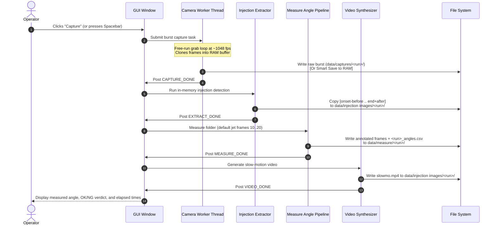
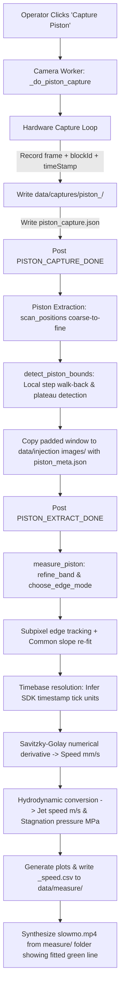
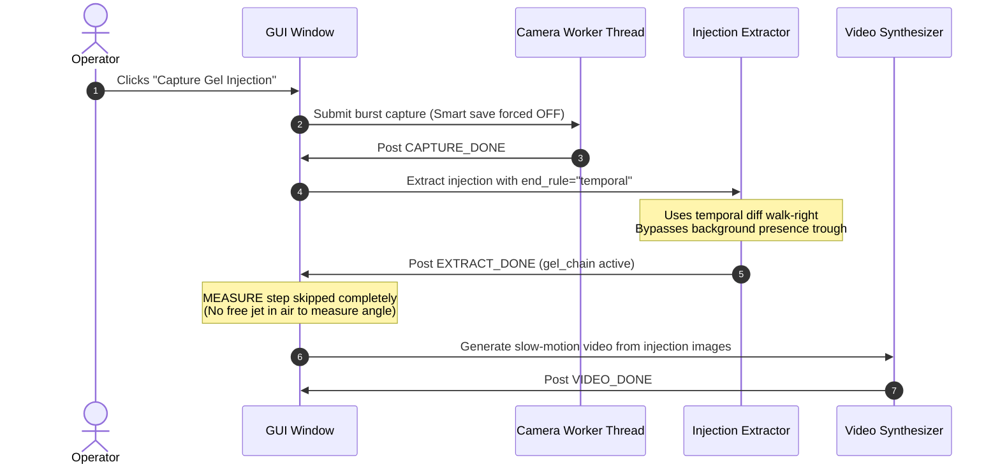
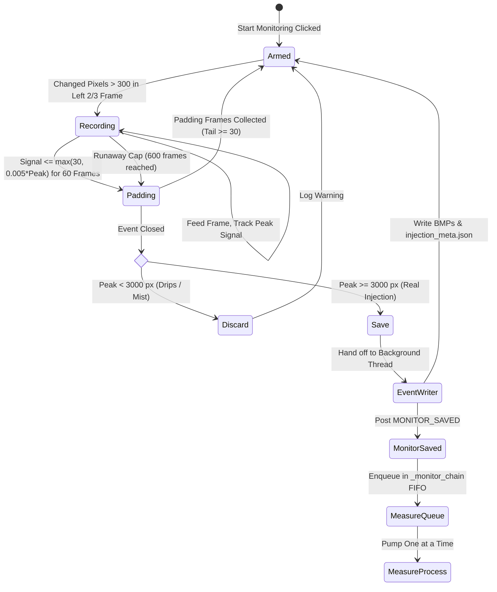
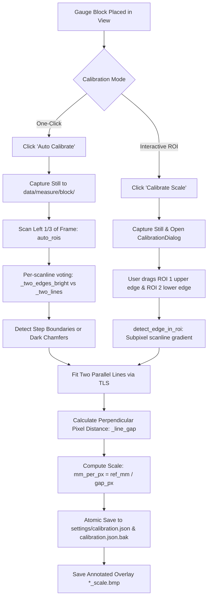

# End-to-End Test Workflows & Pipelines

This document details all eight distinct operational and test workflows supported by the system. Each workflow is documented with its user triggers, internal state transitions, data flows, inputs, outputs, and edge-case handling.

---

## 1. Summary Matrix of Workflows

| # | Workflow Name | Primary User Button | Hardware Required | Primary Output | Downstream Chaining |
| :--- | :--- | :--- | :--- | :--- | :--- |
| **1** | **Spray Angle Measurement** | `Capture` | Camera + Injector | Spray angle, cone lines, OK/NG verdict | Capture $\to$ Extract $\to$ Measure $\to$ Video |
| **2** | **Piston Speed & Travel** | `Capture Piston` | Camera + Injector | Distance/speed curves, peak jet pressure | Piston Capture $\to$ Extract $\to$ Measure $\to$ Video |
| **3** | **Gel Injection Capture** | `Capture Gel Injection`| Camera + Gel Rig | Isolated injection images, video | Gel Capture $\to$ Temporal Extract $\to$ Video |
| **4** | **Continuous Monitoring** | `Start Monitoring` | Camera + Multi-Shot | Continuous series of measured events | Stream $\to$ FSM Event $\to$ EventWriter $\to$ Measure |
| **5** | **Spatial Calibration** | `Calibrate Scale` / `Auto Calibrate` | Camera + Gauge Block | `calibration.json` (scale $\text{mm/px}$) | Still Grab $\to$ ROI Edge Detection $\to$ TLS Gap |
| **6** | **Angle Block Verification**| `Measure Angle Block`| Camera + Angle Block | `block_angles.csv` | Still Grab $\to$ Edge Fit $\to$ Acute Angle |
| **7** | **Nozzle Reference Setup** | `Set Reference` | Camera + Dry Nozzle | `reference_lines.json` (tip, axis, rect) | Still Grab $\to$ User Line Drag $\to$ Axis Build |
| **8** | **Cross-Run Summary** | `Summary` | None (Disk Only) | `summary_<stamp>.csv` | Multi-Folder Selection $\to$ Statistical Aggregation |

---

## 2. Workflow 1: Spray Angle Measurement Pipeline

### 2.1 Description
Measures the divergence (spray cone angle) and angular deflection of a high-pressure water jet fired into ambient air. The test assesses whether the liquid stream remains tightly focused and aligned with the physical nozzle axis.

### 2.2 Execution Sequence


### 2.3 Detailed Pipeline Stages
1. **Burst Acquisition**: Camera free-runs for `capture_time` (default $4.0\ \text{s}$, $\sim 4,200$ frames at 320x240). Frames are cloned into RAM and saved as 8-bit uncompressed BMPs (`frame_000001.bmp` $\dots$).
2. **Injection Extraction**:
   - Computes temporal motion signal: $S_t = \sum |I_t - I_{t-1}| > 25$.
   - Locates peak injection frame.
   - Walks left on $S_t$ to locate onset frame.
   - Computes pre-onset background: temporal median of $120$ frames preceding onset.
   - Scans forward using a jet-presence mask to find where the jet clears the scene (post-jet trough).
   - Extracts $[ \text{onset} - 30 \dots \text{end} + 30 ]$ into `data/injection images/<run>/`.
3. **Spray Angle Measurement**:
   - Identifies jet frames (counting from the first frame exhibiting a valid jet, skipping pre-injection padding).
   - Evaluates frames $10\dots20$ (the steady state, avoiding the unstable opening transient).
   - Subpixel gradient edge extraction + erf fitting.
   - Fits Total Least Squares (TLS) lines to upper and lower edges after RANSAC outlier elimination.
   - Deviations measured against the stored blue nozzle centerline.
   - Checks if upper/lower lines stay inside the target reference rectangle ($\to \text{OK} / \text{NG}$).
4. **Slow-Motion Synthesis**: Generates `slowmo.mp4` at $15\ \text{fps}$ for visual verification.

---

## 3. Workflow 2: Piston Speed & Travel Tracking

### 3.1 Description
Tracks the injector's mechanical piston as it advances down the transparent ampoule barrel, measuring displacement, stroke duration, instantaneous velocity, and resulting hydrodynamic jet pressures.

### 3.2 Execution Sequence


### 3.3 Critical Technical Policies
1. **Separate Capture Loop**: Piston capture runs `_do_piston_capture` separately from the spray capture loop. It never uses the spray motion signal (which tracks the jet, not the piston).
2. **Hardware Timestamp Preservation**: The IMV SDK frame metadata (`blockId` and `timeStamp`) are recorded for every single frame into `piston_capture.json`. Gaps in `blockId` detect dropped frames; timestamps establish the honest timebase.
3. **Timebase Inference**: `resolve_timebase` tests candidate tick multipliers ($\mu\text{s}$, $\text{ns}$, $\text{ms}$) against the measured camera frame rate (`TIMEBASE_TOL = 0.05`). Timestamps are only accepted if their implied frame rate matches physical camera acquisition.
4. **Common Slope Projection**: Because the piston is a rigid body traveling axially down the barrel, all frames are fitted with a single pooled slope. Individual frames only solve for translational offset, preventing artificial angular jitter.
5. **Video Source**: The slow-motion video is generated from `data/measure/<run>/` rather than `injection images/`. This ensures the operator visually inspects the tracking line throughout the entire stroke.

---

## 4. Workflow 3: Gel Injection Capture

### 4.1 Description
Captures a needle-free injection fired into a block of transparent ballistic gelatin. Unlike air, gel remains permanently deformed, dyed, and pocketed with fluid after the event.

### 4.2 Execution Sequence


### 4.3 Why Gel Capture Differs
- **End Rule Selection**: Standard presence-end detection searches for a trough where the scene clears back to baseline. In gel, the scene never clears; presence stays high indefinitely. The gel pipeline forces `end_rule="temporal"`, defining the end of the event when frame-to-frame motion drops below the noise floor.
- **Smart Save Disabled**: Smart save plans its window using presence by default. Because presence would run to the timeout cap in gel, Smart save is forced OFF.
- **Measurement Bypassed**: There is no free cone in air; fitting spray lines inside a fractured gel cavity produces meaningless numbers.

---

## 5. Workflow 4: Continuous Multi-Injection Monitoring

### 5.1 Description
Enables hands-free testing of multi-dose injector batches. The camera streams continuously while an operator fires multiple injections in succession. Each injection is detected online, saved in the background, and queued for sequential measurement.

### 5.2 State Machine & Queue Processing


### 5.3 Safeguards & Design Decisions
1. **Left Two-Thirds Detection ROI (`MON_DETECT_FRAC = 2/3`)**: The injector nozzle is located on the right edge. Operators frequently touch, remove, or reinstall ampoules while monitoring runs. Churn on the right edge is ignored; only liquid entering the left $66\%$ of the frame triggers an event. Full-width frames are saved.
2. **Peak Validation (`MON_MIN_PEAK = 3000 px`)**: Drips, mist, or accidental bench taps trigger $300\dots760$ pixels. Genuine high-pressure injections peak between $6,000$ and $55,000$ changed pixels. Events peaking below $3,000$ are flagged as `discarded` and never written to disk.
3. **Sequential Pipeline Pumping**: Even if an operator fires a second shot while the previous event is being measured, the camera thread never stalls. The event writer saves the frames, and the UI drains events sequentially through the angle measurement engine.

---

## 6. Workflow 5: Spatial Scale Calibration & Gauge Block Measurement

### 6.1 Description
Establishes the absolute physical scale ($\text{mm/px}$) by imaging a precision gauge block of known thickness (default $5.0\ \text{mm}$ or $10.0\ \text{mm}$) placed at the injector nozzle position.



### 6.2 Polarity & Fit Modes
The detector automatically recognizes block optical polarity:
- **`step` Mode (Modern Gauge Block)**: Block images as a solid bright rectangular bar on a dark background. Reference edges are the upper and lower bright $\leftrightarrow$ dark transition steps (gradient peak).
- **`outer` Mode (Chamfered Block)**: Block surfaces reflect light, but beveled/chamfered edges reflect light away, appearing as two parallel **dark lines**. The true block boundary is the **outer flank** of the dark line facing away from the opposite edge.

---

## 7. Workflow 6: Angle Block Verification

### 7.1 Description
Captures a precision machined angle block placed under the camera and measures the acute angle between its two straight edges. Serves as a metrology benchmark to verify line fitting accuracy without a dynamic water jet.

### 7.2 Execution Flow
1. Operator clicks **Measure Angle Block**.
2. Camera grabs a still to `data/measure/angle_block/block_<timestamp>.bmp`.
3. Image is segmented with Otsu on raw grayscale (no temporal subtraction needed for a static block).
4. Longest outer boundaries are extracted via subpixel gradient extrema.
5. Lines are fitted using RANSAC $\to$ TLS over the full edge length.
6. Acute angle $\theta = |\arctan(k_{\text{upper}}) - \arctan(k_{\text{lower}})|$ is calculated.
7. Results are appended to `block_angles.csv` and an annotated overlay image is displayed.

---

## 8. Workflow 7: Nozzle Reference & Target Rectangle Alignment

### 8.1 Description
Defines the spray reference coordinate frame: the physical nozzle tip edge, the perpendicular spray axis (centerline), and a tolerance target rectangle.

### 8.2 Alignment Steps
```
1. Click "Set Reference"
2. Camera grabs a dry nozzle still -> Opens ReferenceDialog
3. Operator drags a line directly along the physical NOZZLE TIP EDGE (Red Line)
4. System automatically computes:
   - Midpoint of tip line
   - Perpendicular unit vector directed downstream (Blue Centerline / Spray Axis)
   - Red Target Rectangle:
     * Near edge: 1.00 mm downstream from tip
     * Far edge:  6.51 mm downstream from tip
     * Height:    0.775 mm full height (centered on Blue Centerline)
5. Atomically saved to settings/reference_lines.json (+ backup .bak)
```

> [!WARNING]
> **Frame Size Sensitivity**:
> The nozzle reference is stored in pixel coordinates for the specific capture resolution it was created at (e.g. $320 \times 240$). If capture resolution changes (e.g. to $320 \times 120$), the reference is ignored, spray angle reverts to raw edge-to-edge calculation, and the `in_rect` column is left blank. Operators must re-set the reference when switching ROI presets.

---

## 9. Workflow 8: Batch Cross-Run Statistical Summary

### 9.1 Description
Aggregates performance metrics across multiple piston test runs to answer: *"Is this injector repeatable across a batch?"*

### 9.2 Execution Steps
1. Operator clicks **Summary** in the GUI.
2. A multi-folder selector (`RunPicker`) lists measured runs newest-first, filtering only folders containing `*_speed.csv`.
3. Operator selects $N$ runs and clicks **Analyze**.
4. For each run, `hsc/summary.py` extracts the metric summary block:
   - Stroke length ($S_{\text{mm}}$)
   - Peak piston speed ($v_{\text{peak, mm/s}}$)
   - Stroke duration ($t_{\text{stroke, ms}}$)
   - Peak jet velocity ($v_{\text{jet, m/s}}$)
   - Peak stagnation impact pressure ($P_{\text{jet, MPa}}$)
5. Aggregates descriptive statistics across all runs:
   - Count ($n$)
   - Arithmetic Mean ($\mu$)
   - Sample Standard Deviation ($\sigma$)
   - **Coefficient of Variation ($CV\% = \frac{\sigma}{\mu} \times 100$)**
   - Minimum, Median, Maximum
6. Writes `summary_<timestamp>.csv` to `data/measure/` and displays the formatted table in a scrollable UI view.
