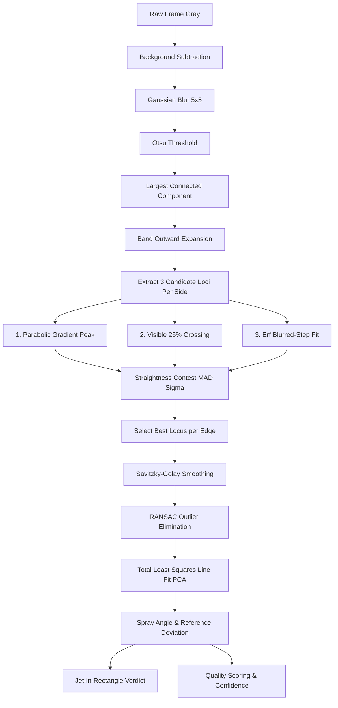

# Algorithms & Mathematical Formulations

This document provides complete mathematical definitions, signal processing models, computer vision algorithms, and pseudocode implementations for the needle-free injector test toolkit. It is specifically designed to allow exact reimplementation in C++, Rust, or other systems languages.

---

## 1. Temporal Motion Signal & Injection Bounds Detection

### 1.1 Motion Signal Formulation
To isolate transient high-speed injection events amidst gradual scene lighting drift, the system analyzes frame-to-frame pixel change:

$$S_t = \sum_{y=0}^{H-1} \sum_{x=0}^{W-1} \mathbb{I}\left( |I_t(x, y) - I_{t-1}(x, y)| > T_{\text{diff}} \right)$$

where:
- $I_t(x, y) \in [0, 255]$ is the 8-bit grayscale pixel intensity of frame $t$.
- $T_{\text{diff}} = 25$ (`DIFF_THRESH`) is the intensity difference threshold.
- $\mathbb{I}(\cdot)$ is the indicator function returning $1$ if true, $0$ otherwise.
- For $t = 0$, $S_0 = 0$.

### 1.2 Peak Detection & Onset Walk-Back
1. **Locate Peak Index**:
   $$t_{\text{peak}} = \arg\max_{t} S_t, \quad S_{\max} = S_{t_{\text{peak}}}$$
   If $S_{\max} < 300.0$ (`min_peak`), reject the burst as containing no injection event.
2. **Adaptive Motion Threshold**:
   $$T_{\text{motion}} = \max\left(30.0, 0.005 \times S_{\max}\right)$$
3. **Onset Walk-Left**:
   Starting from $t_{\text{peak}}$, decrement $t \gets t - 1$. Maintain consecutive miss counter $m$.
   - If $S_t > T_{\text{motion}}$, update $t_{\text{onset}} \gets t$ and reset $m \gets 0$.
   - If $S_t \le T_{\text{motion}}$, increment $m \gets m + 1$.
   - If $m > 5$ (`gap`), terminate walk. The onset is $t_{\text{onset}}$.

### 1.3 End-of-Injection Detection (Dual-Rule Formulation)

#### Rule A: Presence-Based End Rule (`end_rule = "presence"`, Free-Air Jet)
A steady water jet exhibits little frame-to-frame motion once established, so temporal difference drops prematurely. The true end of injection is detected by measuring residual wetness against pre-injection background.

1. **Pre-Onset Background Image ($B$)**:
   Sample $N_{\text{pre}} = 120$ frames preceding $t_{\text{onset}}$ (leaving a gap of 20 frames):
   $$B(x, y) = \operatorname{median}_{t \in [t_{\text{onset}}-120, t_{\text{onset}}-20]} I_t(x, y)$$
2. **Jet Region Mask ($M$)**:
   Downsampled by factor $D = 4$:
   $$M(x_d, y_d) = \mathbb{I}\left( |I_{t_{\text{peak}}}(4x_d, 4y_d) - B(4x_d, 4y_d)| > 40 \right)$$
3. **Presence Signal ($P_k$)**:
   For each frame $k \in [t_{\text{peak}}, \min(N, t_{\text{peak}} + 1500)]$:
   $$P_k = \sum_{x_d, y_d} \mathbb{I}\left( |I_k(4x_d, 4y_d) - B(4x_d, 4y_d)| > 25 \right) \times M(x_d, y_d)$$
4. **Moving Average Smoothing**:
   Convolve $P$ with a uniform kernel of size $W_{\text{smooth}} = 21$:
   $$\bar{P} = P * \left(\frac{1}{21} \mathbf{1}_{21}\right)$$
5. **Trough Thresholding**:
   Identify minimum smoothed presence $P_{\min} = \min(\bar{P})$.
   $$T_{\text{low}} = \max\left(2.0, 1.8 \times P_{\min}\right)$$
   Starting at $k = t_{\text{peak}} + 8$, locate the first index where $\bar{P}_k \le T_{\text{low}}$ holds for $25$ (`END_HOLD`) consecutive frames.
   The frame where this condition is met is $t_{\text{end}}$.

#### Rule B: Temporal-Only End Rule (`end_rule = "temporal"`, Ballistic Gel)
In ballistic gel, fluid accumulation and permanent cavity expansion mean the scene never returns to baseline ($P_k$ never enters a trough).
- Walk forward from $t_{\text{peak}}$ along $S_t$:
  $$t_{\text{end}} = \max \{ t > t_{\text{peak}} \mid S_t > T_{\text{motion}} \text{ with miss } \le 5 \}$$

### 1.4 Copy Window Bounding
The extracted window indices copied to disk or memory are clamped:
$$k_{\text{start}} = \max(0, t_{\text{onset}} - 30), \quad k_{\text{end}} = \min(N - 1, t_{\text{end}} + 30)$$

---

## 2. Spray Angle Measurement Pipeline



### 2.1 Preprocessing & Background Subtraction
For sequence measurements, background image $B(x, y)$ is computed as the per-pixel temporal median of the pre-onset padding frames (minimum 8 frames).

Working difference image:
$$I_{\text{work}}(x, y) = \operatorname{clip}\left( I_{\text{gray}}(x, y) - B(x, y), 0, 255 \right)$$

If $99.5\text{-th}$ percentile of $I_{\text{work}} < 80$ (`MIN_PEAK`), no measurable jet is present.

### 2.2 Connected Component Segmentation
1. Apply Gaussian smoothing with $5 \times 5$ kernel ($\sigma \approx 0.8$).
2. Compute global binary Otsu threshold:
   $$T_{\text{otsu}} = \arg\max_T \sigma_B^2(T)$$
   $$M_{\text{bin}}(x, y) = \begin{cases} 255, & I_{\text{blur}}(x, y) \ge T_{\text{otsu}} \\ 0, & \text{otherwise} \end{cases}$$
3. Find 8-connected components. Select component $C_{\max}$ with largest area.
   If $\operatorname{Area}(C_{\max}) < 120$ (`MIN_AREA`), frame is rejected.

### 2.3 Band Outward Expansion
A steady jet can partially bleed into the background median, causing the Otsu difference mask to terminate inside the visible edge.
For each column $x$ in $C_{\max}$:
1. Identify mask top and bottom rows: $y_{\text{top}}, y_{\text{bot}}$.
2. Find core brightness: $V_{\text{core}} = \max_{y \in [y_{\text{top}}, y_{\text{bot}}]} I_{\text{smooth}}(x, y)$.
3. Baseline level: $V_{\text{bg}} = 20\text{-th percentile}(I_{\text{smooth}}(:, x))$.
4. Threshold: $T_{\text{band}} = V_{\text{bg}} + 0.15 \times (V_{\text{core}} - V_{\text{bg}})$.
5. Expand $y_{\text{top}}$ upward while $I_{\text{smooth}}(x, y_{\text{top}}-1) > T_{\text{band}}$ (capped at 12 px).
6. Expand $y_{\text{bot}}$ downward while $I_{\text{smooth}}(x, y_{\text{bot}}+1) > T_{\text{band}}$ (capped at 12 px).

### 2.4 Candidate Edge Loci Formulation
Within column segment $y \in [y_0, y_1]$ (where $y_0 = y_{\text{top}} - 3$, $y_1 = y_{\text{bot}} + 3$):
Let $g(y) = \frac{d}{dy} I_{\text{smooth}}(x, y)$ be the 1D vertical central-difference gradient.
Core row index: $y_{\text{core}} = \arg\max_{y} I_{\text{smooth}}(x, y)$.

#### Candidate 1: Parabolic Sub-Pixel Gradient Vertex
- Upper edge integer peak: $i_t = \arg\max_{y < y_{\text{core}}} g(y)$.
- Lower edge integer peak: $i_b = \arg\min_{y > y_{\text{core}}} g(y)$.
- Fit a 3-point vertical parabola through $(i-1, g[i-1])$, $(i, g[i])$, $(i+1, g[i+1])$:
  $$\delta_{\text{sub}} = \frac{1}{2} \frac{g[i-1] - g[i+1]}{g[i-1] - 2g[i] + g[i+1]}$$
  Bound: If $|\delta_{\text{sub}}| > 0.5$ or denominator is 0, $\delta_{\text{sub}} = 0.0$.
  $$y_{\text{grad}} = y_0 + i + \delta_{\text{sub}}$$

#### Candidate 2: Visible Edge Crossing (25% Threshold)
Walk outward from integer peak $i$ away from core until column intensity crosses:
$$T_{\text{vis}} = V_{\text{bg}} + 0.25 \times (V_{\text{core}} - V_{\text{bg}})$$
Linearly interpolate subpixel crossing between consecutive rows $r$ and $r+1$:
$$y_{\text{vis}} = y_0 + r + \frac{T_{\text{vis}} - I(r)}{I(r+1) - I(r)}$$

#### Candidate 3: Error Function (erf) Blurred-Step Model
Fit an analytical blurred edge model per column per side over window $[i - 5, i + 5]$:
$$I(y) = \text{base} + \text{amp} \times \frac{1}{2} \left[ 1 + \operatorname{erf}\left( \pm \frac{y - \mu}{\sigma \sqrt{2}} \right) \right]$$
where:
- $\operatorname{erf}(z) = \frac{2}{\sqrt{\pi}} \int_0^z e^{-t^2} dt$.
- Sign is $+1$ for upper edge, $-1$ for lower edge.
- Free parameters solved via Levenberg-Marquardt non-linear least squares:
  - $\mu$: Sub-pixel step position.
  - $\sigma$: Edge ramp width (constrained $\sigma \in [0.3, 5.0]$).
  - $\text{base}$: Local background floor.
  - $\text{amp}$: Edge step height (constrained $\ge 8.0$).
- Normalized confidence:
  $$C_{\text{erf}} = \operatorname{clip}\left(1.0 - \frac{\text{RMSE}}{\text{amp}}, 0.0, 1.0\right)$$

### 2.5 Straightness Contest (Locus Selection)
For ROI columns $X_{\text{ROI}}$:
For each candidate locus $y \in \{y_{\text{grad}}, y_{\text{vis}}, y_{\text{erf}}\}$:
1. Fit linear ordinary least squares: $y_{\text{fit}} = k x + b$.
2. Compute residuals: $r_i = y_i - (k x_i + b)$.
3. Calculate robust spread using Normalized Median Absolute Deviation (MAD):
   $$\sigma_{\text{robust}} = 1.4826 \times \operatorname{median}\left( |r_i - \operatorname{median}(r_i)| \right)$$
4. Selection Rule:
   Later candidates (`vis`, `erf`) represent physically sharper edges and are preferred over conservative gradient peaks unless the gradient locus is significantly straighter:
   $$\text{Candidate wins if } \sigma_{\text{cand}} \le 1.10 \times \sigma_{\text{best}}$$
   (`EDGE_PICK_TOL = 1.10`).

---

## 3. Robust Line Fitting: RANSAC $\to$ Total Least Squares (TLS)

Ordinary least squares assumes all noise is vertical ($\epsilon_y$). In spray angles and edge detection, both $X$ and $Y$ coordinates contain physical noise. Total Least Squares (orthogonal regression) is mandatory.

### 3.1 RANSAC Outlier Elimination
1. Linear model: $y = k x + b$.
2. Residual threshold: $T_{\text{RANSAC}} = 2.5\ \text{px}$.
3. Discard splash droplets, breakaway spray, and detached mist. Keep inlier set $\mathcal{I}$.

### 3.2 Total Least Squares via PCA Eigendecomposition
Given $N$ inlier 2D points $(x_i, y_i) \in \mathcal{I}$:
1. Compute centroid:
   $$\bar{x} = \frac{1}{N} \sum_{i=1}^N x_i, \quad \bar{y} = \frac{1}{N} \sum_{i=1}^N y_i$$
2. Construct $2 \times 2$ sample covariance matrix:
   $$\mathbf{C} = \frac{1}{N} \sum_{i=1}^N \begin{bmatrix} (x_i - \bar{x})^2 & (x_i - \bar{x})(y_i - \bar{y}) \\ (x_i - \bar{x})(y_i - \bar{y}) & (y_i - \bar{y})^2 \end{bmatrix} = \begin{bmatrix} C_{xx} & C_{xy} \\ C_{xy} & C_{yy} \end{bmatrix}$$
3. Eigenvalues and Eigenvectors:
   $$\det(\mathbf{C} - \lambda \mathbf{I}) = 0 \implies \lambda^2 - (C_{xx} + C_{yy})\lambda + (C_{xx}C_{yy} - C_{xy}^2) = 0$$
   Largest eigenvalue $\lambda_{\max}$ corresponds to major axis direction vector $\mathbf{v} = (v_x, v_y)^T$.
   Canonically orient such that $v_x \ge 0$.
4. Slope and Intercept:
   $$k = \frac{v_y}{v_x}, \quad b = \bar{y} - k \bar{x}$$

---

## 4. Angular Calculations & Reference Alignment

### 4.1 Free-Air Spray Angle (No Reference Set)
The total opening cone angle between upper line $(k_{\text{up}}, b_{\text{up}})$ and lower line $(k_{\text{lo}}, b_{\text{lo}})$:
$$\theta_{\text{spray}} = \left| \arctan(k_{\text{up}}) - \arctan(k_{\text{lo}}) \right| \times \frac{180}{\pi}$$

### 4.2 Deviation Angle from Spray Axis (Reference Active)
Given nozzle centerline unit direction vector $\mathbf{d}_{\text{blue}} = (d_x, d_y)^T$ and edge line direction vector $\mathbf{d}_{\text{edge}} = (v_x, v_y)^T$:
$$\theta_{\text{acute}} = \operatorname{atan2}\left( |\mathbf{d}_{\text{blue}} \times \mathbf{d}_{\text{edge}}|, |\mathbf{d}_{\text{blue}} \cdot \mathbf{d}_{\text{edge}}| \right) \times \frac{180}{\pi}$$
where:
- $\mathbf{d}_{\text{blue}} \times \mathbf{d}_{\text{edge}} = d_x v_y - d_y v_x$ (2D cross product scalar).
- $\mathbf{d}_{\text{blue}} \cdot \mathbf{d}_{\text{edge}} = d_x v_x + d_y v_y$.
- Compute $\theta_{\text{upper}}$ and $\theta_{\text{lower}}$.
- **Reported Angle**: $\theta = \max(\theta_{\text{upper}}, \theta_{\text{lower}})$ (worst-case deflection).
- Under `ANGLE_POLICY = "trusted"`: If exactly one edge has Low confidence, report the trusted edge alone.

### 4.3 Jet-in-Rectangle Containment Test
Given target tolerance rectangle $[x_{\min}, x_{\max}] \times [y_{\min}, y_{\max}]$:
Since fitted lines are straight, testing both edge lines at bounding interval endpoints $x \in \{x_{\min}, x_{\max}\}$ guarantees full containment:
$$\text{Verdict} = \text{OK} \iff \forall x \in \{x_{\min}, x_{\max}\}: \begin{cases} y_{\min} \le k_{\text{up}} x + b_{\text{up}} \le y_{\max} \\ y_{\min} \le k_{\text{lo}} x + b_{\text{lo}} \le y_{\max} \end{cases}$$
Otherwise verdict is $\text{NG}$.

---

## 5. Quality Evaluation & Confidence Standard

Every measured frame receives a $0\dots100$ quality score using a weakest-link formulation:

$$Q_{\text{frame}} = \min\left( S_{\text{fit}}, S_{\text{coverage}}, S_{\text{span}} \right)$$

### 5.1 Sub-Score Ramp Functions
$$S(V, V_{\text{good}}, V_{\text{bad}}) = \operatorname{clip}\left( \frac{V - V_{\text{bad}}}{V_{\text{good}} - V_{\text{bad}}}, 0.0, 1.0 \right) \times 100.0$$

1. **Fit Straightness ($S_{\text{fit}}$)**:
   $V = \max(\text{RMS}_{\text{up}}, \text{RMS}_{\text{lo}})$.
   $V_{\text{good}} = 0.25\ \text{px} \to 100$, $V_{\text{bad}} = 1.00\ \text{px} \to 0$.
2. **Column Coverage ($S_{\text{coverage}}$)**:
   $V = \frac{\text{Valid ROI Columns}}{\text{ROI Width}}$.
   $V_{\text{good}} = 0.98 \to 100$, $V_{\text{bad}} = 0.80 \to 0$.
3. **Jet Span Ratio ($S_{\text{span}}$)**:
   $V = \frac{\text{Jet Span This Frame}}{\text{Max Jet Span in Run}}$.
   $V_{\text{good}} = 0.92 \to 100$, $V_{\text{bad}} = 0.60 \to 0$.

### 5.2 Confidence Categorization
- $Q \ge 75 \implies \mathbf{High}$
- $50 \le Q < 75 \implies \mathbf{Medium}$
- $Q < 50 \implies \mathbf{Low}$

---

## 6. Piston Edge Tracking & Hydrodynamics

The piston is a **dark body traversing a bright barrel interior** (the optical inverse of the water jet).

```
Barrel Top Wall (Dark)
-----------------------------------------------------------------
Barrel Interior (Bright)         [ Piston Body (Dark) ]
                          Left Edge -> | 
-----------------------------------------------------------------
Barrel Bottom Wall (Dark)
```

### 6.1 Barrel Profile & Body Sweep Formulation
1. Temporal max image $I_{\max}(x, y) = \max_t I_t(x, y)$ (bright where barrel is ever empty).
2. Temporal min image $I_{\min}(x, y) = \min_t I_t(x, y)$ (dark where piston ever passed).
3. Bright barrel row detection: Rows where Otsu threshold fraction $\ge 0.5$, inset by $12\%$ to avoid wall reflections.
4. **Swept Body Filtering (`_restrict_to_body`)**:
   Keep only rows where:
   $$\text{Swept}(x, y) = \left( I_{\min}(x, y) < T_{\text{mid}} \right) \land \left( I_{\max}(x, y) \ge T_{\text{mid}} \right)$$
   exhibits a run length $\ge 0.5 \times \text{MaxRun}$. This prevents stationary mounting rods or holders from corrupting the row band.

### 6.2 Subpixel Dark Edge Column Detection
Within the row band:
1. Smooth row with 1D Gaussian ($\sigma = 1.0$).
2. Locate the first run of at least $30\ \text{px}$ (`MIN_BODY_RUN`) darker than:
   $$T_{\text{body}} = V_{\text{dark}} + 0.08 \times (V_{\text{bright}} - V_{\text{dark}})$$
3. Within $\pm 4\ \text{px}$ of the run start, find the minimum gradient (steepest bright $\to$ dark step).
4. Apply parabolic vertex interpolation to locate sub-pixel edge column $x_e(y)$.

### 6.3 Common Slope Pooling
The piston is a rigid solid cylinder. Its tilt does not change mid-stroke.
1. Center each frame's detected edges: $\tilde{x}_i(y) = x_i(y) - \operatorname{median}(x_i)$.
2. Pool centered points across all stroke frames:
   $$k_{\text{common}} = \operatorname{TLS\_Slope}\left( \bigcup_{\text{all frames}} (y, \tilde{x}) \right)$$
3. Re-fit each frame with fixed slope $k_{\text{common}}$, solving only for translation intercept $b$:
   $$b_t = \operatorname{median}\left( x_t(y) - k_{\text{common}} y \right)$$
   $$x_{\text{center}, t} = k_{\text{common}} y_{\text{center}} + b_t$$

### 6.4 Stroke Bounds Detection
To avoid baseline drift triggering stroke detection prematurely over thousands of resting frames:
1. Rest baseline: $x_{\text{base}} = \operatorname{median}(x_{0\dots19})$.
2. Stroke trigger:
   $$T_{\text{stroke}} = \max\left(0.6\ \text{px}, 5 \sigma_{\text{base}}, 0.05 \times \text{Travel}_{\text{total}}\right)$$
3. Confirmed motion index: First index where $|x_t - x_{\text{base}}| > T_{\text{stroke}}$ holds for 3 consecutive frames.
4. **Local Step Walk-Back**: Walk backward from confirmed index using local step $\Delta x_t = |x_t - x_{t-1}|$ until $\Delta x_t \le 0.25 \times \Delta x_{\text{mid-stroke}}$ holds for 5 consecutive frames. This marks $t_{\text{stroke, start}}$.
5. **Plateau Detection**: Settle tolerance $T_{\text{plateau}} = \max(0.6, 0.25 \times \Delta x_{\text{step}} \times 15)$. First index where moving range over 15 frames $\le T_{\text{plateau}}$ marks $t_{\text{stroke, end}}$.

### 6.5 Savitzky-Golay Numerical Differentiation
Given displacement series $d_t$ in millimeters and timestamps $t$ in seconds:
For uniform sampling ($\Delta t$ constant within $20\%$):
$$v(t) = \operatorname{SavitzkyGolayDerivative}\left(d_t, \text{window}=15, \text{poly}=2, \Delta t\right)$$
For non-uniform timestamps, apply central differences:
$$v(t_i) = \frac{d_{i+1} - d_{i-1}}{t_{i+1} - t_{i-1}}$$

### 6.6 Fluid Mechanics & Hydrodynamic Conversion

Using the continuity equation for incompressible fluids:
$$A_{\text{barrel}} v_{\text{piston}} = A_{\text{orifice}} v_{\text{jet}}$$
$$\frac{\pi D_{\text{barrel}}^2}{4} v_{\text{piston}} = \frac{\pi D_{\text{orifice}}^2}{4} v_{\text{jet}}$$

$$\mathbf{v_{\text{jet}} = v_{\text{piston}} \left( \frac{D_{\text{barrel}}}{D_{\text{orifice}}} \right)^2 \times \frac{1}{1000} \quad [\text{m/s}]}$$

where $v_{\text{piston}}$ is in $\text{mm/s}$.

The stagnation impact pressure is the dynamic pressure of the liquid stream:
$$\mathbf{P_{\text{stagnation}} = \frac{1}{2} \rho v_{\text{jet}}^2 \times 10^{-6} \quad [\text{MPa}]}$$

where:
- $\rho = 1000.0\ \text{kg/m}^3$ (water density).
- Factor $10^{-6}$ converts Pascals ($\text{N/m}^2$) to Megapascals ($\text{MPa}$).
