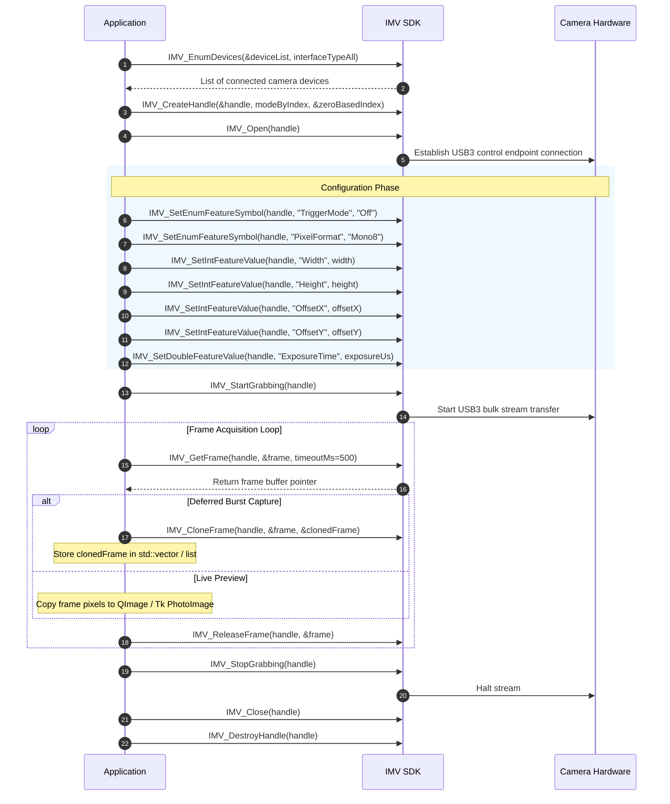

# Camera Hardware & IMV SDK Integration

This document details the Huaray / iRayple Industrial Machine Vision (IMV) SDK integration, GenICam register configurations, memory management patterns, hardware timestamp handling, and runtime DLL dependencies.

---

## 1. IMV SDK Architecture & Component Layout

The camera communicates through the Huaray / iRayple GenICam GenTL driver stack:

```
[ Application (C++ / Python) ]
          │
[ IMV C API: IMVApi.h / MVSDKmd.lib / IMVApi.py ]
          │
[ MVSDKmd.dll (x64) ]
   ├── MVProducerU3V.cti (USB3 Vision GenTL Producer)
   ├── MVProducerGEV.cti (GigE Vision Producer)
   ├── GenApi_MD_VC120_v3_0.dll / GenApi_MD_VC141_v3_4.dll
   └── GCBase / Log4cpp / TinyXml
          │
[ Windows Kernel USB3 Bus Driver ]
          │
[ Huaray AH7040MU000 Camera Hardware ]
```

### 1.1 Vendored Library Layout
In both Python (`vendor/`) and C++ (`C version/`), runtime DLLs must reside in `Runtime/x64/` and be present on the application's runtime search path (`PATH` or dynamic DLL load path):
- `Development/Include/IMV/IMVApi.h`: Primary C API header.
- `Development/Include/IMV/IMVDefines.h`: Constants, error codes, frame structs.
- `Development/Lib/x64/MVSDKmd.lib`: MSVC import library (64-bit).
- `Runtime/x64/MVSDKmd.dll`: Core SDK runtime.
- `Runtime/x64/MVProducerU3V.cti`: GenTL producer required for USB3 discovery.

---

## 2. Standard SDK Call Lifecycle (Mandatory Sequence)

The IMV SDK enforces a strict order of operations. Deviations cause error returns or hardware deadlocks:



---

## 3. Register Configuration & GenICam Features

### 3.1 Feature Reference Table
The following features are configured before streaming starts:

| GenICam Feature | Type | Configured Value | Rig Purpose |
| :--- | :--- | :--- | :--- |
| **`TriggerMode`** | Enum | `"Off"` | Free-run stream (camera internal timing). |
| **`PixelFormat`** | Enum | `"Mono8"` | Raw 8-bit grayscale, 1 byte/pixel. |
| **`Width`** | Integer | `320` (or preset) | Horizontal sensor readout window. |
| **`Height`** | Integer | `240` (or preset) | Vertical sensor readout window. |
| **`OffsetX`** | Integer | Centered or `0` | Horizontal ROI offset. |
| **`OffsetY`** | Integer | Centered or `0` | Vertical ROI offset. |
| **`ExposureTime`** | Double | `100.0` .. `1000.0` $\mu\text{s}$ | Sensor electronic integration time. |
| **`AcquisitionFrameRateEnable`** | Bool | `False` | Disables internal frame throttling. |

### 3.2 Centering ROI Math
When centering an ROI of size $(W, H)$ on a sensor with maximum dimensions $(W_{\max}, H_{\max}) = (2048, 2048)$:
$$\text{OffsetX} = \left\lfloor \frac{W_{\max} - W}{2 \times \text{Inc}_x} \right\rfloor \times \text{Inc}_x$$
$$\text{OffsetY} = \left\lfloor \frac{H_{\max} - H}{2 \times \text{Inc}_y} \right\rfloor \times \text{Inc}_y$$
where $\text{Inc}_x, \text{Inc}_y$ are the step increments reported by `IMV_GetIntFeatureInc`. For CMV4000, increments are typically 4 or 8.

---

## 4. Frame Buffer Structures & Metadata

### 4.1 `IMV_Frame` Data Structure
The SDK provides frames via the `IMV_Frame` struct:

```c
typedef struct _IMV_Frame
{
    unsigned char* pData;           // Pointer to raw image data buffer in SDK memory
    IMV_FrameInfo  frameInfo;       // Detailed frame descriptor
    // ... internal fields
} IMV_Frame;

typedef struct _IMV_FrameInfo
{
    uint64_t            blockId;       // Monotonically increasing hardware frame counter
    uint64_t            timeStamp;     // Hardware timer tick count
    uint32_t            width;         // Frame width in pixels
    uint32_t            height;        // Frame height in pixels
    uint32_t            size;          // Total payload size in bytes
    IMV_EPixelType      pixelFormat;   // gvspPixelMono8 (0x01080001)
    // ...
} IMV_FrameInfo;
```

### 4.2 Hardware Timestamps & `blockId`
1. **`blockId` (Frame Loss Detection)**:
   - Generated by the camera on-chip FPGA for each captured frame.
   - Starts at 1 and increments by 1.
   - If $blockId_{k} - blockId_{k-1} > 1$, frames were dropped across the USB3 bus or host driver. The system logs dropped frames directly from this delta.
2. **`timeStamp` (Honest Time Axis)**:
   - Internal clock tick generated by camera hardware at exposure start.
   - Tick rate depends on internal camera oscillator (typically $1\ \mu\text{s}$, $100\ \text{ns}$, or $1\ \text{ns}$ per tick).
   - In `hsc/measure_piston.py`, `resolve_timebase` correlates the timestamp progression with the measured acquisition frame rate to infer the exact time multiplier, ensuring speeds are calculated against true physical time.

---

## 5. Memory Management & Deferred Burst Saving

### 5.1 The High-Speed Disk I/O Problem
At $320 \times 240$ resolution running at $1,048\ \text{fps}$, the system generates:
- Frame size: $320 \times 240 = 76,800\ \text{bytes} \approx 75\ \text{KB}$.
- Data throughput: $75\ \text{KB} \times 1,048\ \text{fps} \approx 78.6\ \text{MB/s}$.
- File creation frequency: **1,048 files per second**.

While 80 MB/s sequential write speed is trivial for modern NVMe SSDs, **creating 1,000 distinct file handles per second causes Windows NTFS directory lock contention**, resulting in dropped frames.

### 5.2 The Deferred-Save Pattern
To guarantee zero dropped frames during burst capture:
1. **During Burst Grabbing ($4.0\ \text{s}$)**:
   - For every frame received via `IMV_GetFrame`, call `IMV_CloneFrame`.
   - Store the cloned frame handle / buffer pointer into an in-memory queue or `std::vector<IMV_Frame>`.
   - Immediately call `IMV_ReleaseFrame` to free the driver's ring buffer.
   - Zero disk operations occur during active capture.
   - Memory footprint for a 4-second burst:
     $$4,200\ \text{frames} \times 76,800\ \text{bytes} \approx 322.5\ \text{MB (RAM)}$$
2. **After Grabbing Stops**:
   - `IMV_StopGrabbing` is called.
   - Background worker iterates through the RAM array, saving each frame as an uncompressed 8-bit BMP (`IMV_SaveImageToFile` or custom fast BMP writer).
   - Each cloned frame is released via `IMV_ReleaseFrame`.

---

## 6. Error Handling & Robustness Guidelines

1. **Return Code Checking**:
   Every SDK function returns an integer status code (`IMV_OK = 0`). Non-zero returns must be converted to human-readable strings via `IMV_GetErrorMsg(ret)` and logged with error codes.
2. **Deterministic Cleanup**:
   If an acquisition error occurs mid-burst:
   - Grabbing must be stopped: `IMV_StopGrabbing(handle)`.
   - Any currently cloned frames in RAM must be explicitly released with `IMV_ReleaseFrame` to prevent driver buffer leaks.
   - Camera must be closed: `IMV_Close(handle)`.
   - Handle destroyed: `IMV_DestroyHandle(handle)`.
3. **Mono8 Assertion**:
   The camera will fail or silently skip any attempt to set `gvspPixelRGB8` or Bayer formats. Always enforce `PixelFormat = "Mono8"`.
