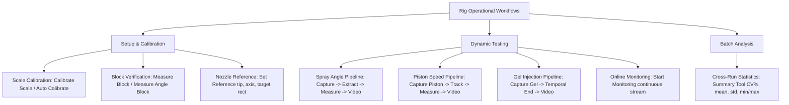

# Needle-Free Injector High-Speed Camera Analysis System — Documentation

Welcome to the comprehensive technical documentation for the **High-Speed Camera Needle-Free Injector Test Rig Toolkit**. This documentation serves as the architectural specification, algorithmic reference, and refactoring blueprint for porting and refining the system into high-performance languages (such as modern C++/Qt or Rust).

---

## 1. System Overview & Purpose

The toolkit is designed for test rigs evaluating needle-free drug delivery injectors. In these devices, high-pressure springs or gas cartridges rapidly drive a piston down a fluid ampoule, ejecting a micro-fine, high-velocity liquid jet through an orifice.

The system performs two primary physical measurements at high frame rates (1,000 to 2,600+ fps):
1. **Spray Angle Measurement**: Visualizes the ejected water jet in free air, detects the jet boundaries to sub-pixel accuracy, fits lines via Total Least Squares (TLS), calculates spray cone expansion and angular deviation from the nozzle axis, and determines pass/fail compliance against a tolerance target rectangle.
2. **Piston Speed & Travel Tracking**: Tracks the internal piston's leading edge through the transparent injector barrel, measures displacement over time, computes stroke duration and velocity via Savitzky-Golay filtering, and calculates the resulting jet exit velocity and stagnation impact pressure.

In addition, the system supports:
- **Gel Injection Capture**: Records injection into translucent ballistic gel blocks using temporal motion criteria.
- **Continuous Multi-Injection Monitoring**: Real-time automated multi-shot detection and background extraction without manual re-arming.
- **Optical Scale Calibration & Reference Setup**: Sub-pixel gauge block calibration (mm/px) and nozzle alignment.
- **Cross-Run Statistical Summary**: Batch analysis of stroke repeatability, peak speeds, and coefficient of variation ($CV\%$).

---

## 2. Documentation Structure

This documentation suite is organized into 9 modular, highly detailed specifications:

| Document | Title | Purpose |
| :--- | :--- | :--- |
| [**01_SYSTEM_OVERVIEW.md**](01_SYSTEM_OVERVIEW.md) | **System & Hardware Specifications** | Physical apparatus, Huaray AH7040MU000 camera, CMV4000 sensor, optics, frame rates, lighting requirements, and environmental constraints. |
| [**02_ARCHITECTURE.md**](02_ARCHITECTURE.md) | **System Architecture & Data Flow** | Dual-stack analysis (Python Tkinter vs. C++/Qt6), directory organization, multithreading model, messaging queues, and component responsibilities. |
| [**03_WORKFLOWS_PIPELINES.md**](03_WORKFLOWS_PIPELINES.md) | **End-to-End Test Workflows** | Detailed execution pipelines for all 8 test and operational workflows, accompanied by Mermaid sequence and flowchart diagrams. |
| [**04_ALGORITHMS_MATHEMATICS.md**](04_ALGORITHMS_MATHEMATICS.md) | **Algorithms & Mathematical Formulations** | Complete mathematical formulations, pseudocode, edge detection models (Otsu, parabolic gradient, erf fit), RANSAC, TLS PCA, Savitzky-Golay, and fluid mechanics. |
| [**05_HARDWARE_AND_SDK.md**](05_HARDWARE_AND_SDK.md) | **Camera Hardware & IMV SDK Integration** | SDK API call sequencing, register configuration, buffer management (`IMV_CloneFrame`), hardware timestamps, ROI timings, and error handling. |
| [**06_DATA_FORMATS_AND_SCHEMAS.md**](06_DATA_FORMATS_AND_SCHEMAS.md) | **Data Formats, Schemas & File Layouts** | Specifications for all metadata files (`injection_meta.json`, `piston_meta.json`, `calibration.json`, `reference_lines.json`), CSV structures, and output hierarchies. |
| [**07_REFACTORING_AND_MIGRATION_GUIDE.md**](07_REFACTORING_AND_MIGRATION_GUIDE.md) | **Refactoring & Language Migration Guide** | Gap analysis of current C++ vs. Python implementations, target C++/Qt6 or Rust architecture, library mappings (OpenCV, Eigen), performance optimizations, and parity verification plan. |
| [**08_CPP_QT6_MIGRATION_PLAN.md**](08_CPP_QT6_MIGRATION_PLAN.md) | **C++20 / Qt 6 Migration & Decoupled Architecture Plan** | Master step-by-step migration plan, pluggable vertical-slice architecture (`IFeatureModule` + `HSC_ENABLE_*` CMake flags), and 7-phase implementation roadmap. |
| [**09_UI_UX_DESIGN_SPECIFICATION.md**](09_UI_UX_DESIGN_SPECIFICATION.md) | **Modern Qt 6 UI/UX & Navigation Bar Specification** | Detailed UI architecture: Left Navigation Sidebar, Split Viewport (pinned live camera on right, dynamic task workspace on left), Results Inspector, top quick-parameter bar, and isolated Settings page. |

---

## 3. High-Level Technology Stack & Codebase State

The current repository contains two coexisting implementations:

### 3.1 Python Implementation (`High speed camera/`)
- **Status**: Production-complete, field-validated on test rigs.
- **Language / Environment**: Python 3.13 managed by `uv`.
- **GUI Framework**: Tkinter (`hsc/gui/` modular mixin architecture).
- **Core Scientific Libraries**: OpenCV (`cv2`), NumPy, SciPy, scikit-learn (`sklearn`), Pillow.
- **Native Acceleration**: Statically compiled MinGW C++/OpenMP scanner (`injection_scan.exe`) for fast raw BMP frame diffing.
- **Packaging**: PyInstaller standalone one-folder distribution (`packaging/`).
- **Test Coverage**: 216 unit/integration tests covering all algorithms, synthetic wedges, synthetic piston strokes, and GUI dispatch.

### 3.2 C++ Implementation (`C version/`)
- **Status**: Production-ready, native C++20 / Qt 6 implementation matching 100% of Python algorithms and pipelines.
- **Language / Toolchain**: C++20, MSVC 2022, CMake 3.31.
- **GUI Framework**: Qt 6.11.1 (Widgets, QGraphicsView, modular workspace tabs).
- **Architecture**: Decoupled vertical feature slices (`src/features/`) registered via `FeatureRegistry` (`IFeatureModule`), enabling modular compilation (`-DHSC_ENABLE_<FEATURE>=ON/OFF`).
- **Sub-components**:
  - `capture_image_cpp.cpp`: Standalone CLI capture utility.
  - `gui/`: Production Qt 6 desktop application with asynchronous `CameraController`, dynamic feature tabs, zoomable live/measurement viewports, and pipeline execution runners.
  - `src/features/`: Fully implemented feature modules (`spray_angle`, `piston`, `gel`, `monitor`, `calibration`, `reference`, `angle_block`, `summary`).
  - `src/foundation/`: Core numerical, I/O, and geometry engines (`tls_fit`, `savgolSmooth21`, `resolveTimebase`, `temporal_scanner`, `bmp_io`, `make_video`, `reference_store`).
- **Test Coverage**: 124 passing native C++ unit tests in `hsc_tests.exe` verifying mathematical and pipeline equivalence.

---

## 4. Primary Test Workflows Matrix

---

## 5. Key Architecture Constraints & Principles

1. **Hardware is strictly Monochrome (Mono8)**: Sensor `AH7040MU000` does not have a Bayer filter. Contrast must arise strictly from optical luminance, not color or dye hue.
2. **Readout Rate is Row-Bound, Not Exposure-Bound**: At 320x240, frame rate is ~1,048 fps regardless of whether exposure is 100 µs or 500 µs. Speed gains require vertical ROI cropping (e.g. 320x120 -> ~1,798 fps).
3. **Physical Scale (mm/px) is Lens Magnification**: Cropping the camera ROI does not invalidate scale calibration (mm/px stays identical). However, changing lens focus, position, or camera distance mandates recalibration.
4. **Nozzle Orientation is Fixed**: By optical rig design, the nozzle sits on the **right** side (`NOZZLE_SIDE = +1`) firing towards the left.
5. **Robust Line Fitting over Ordinary Least Squares**: All angle and piston lines use Total Least Squares (TLS via PCA) after RANSAC outlier elimination, because both $X$ and $Y$ coordinates carry physical image noise.
